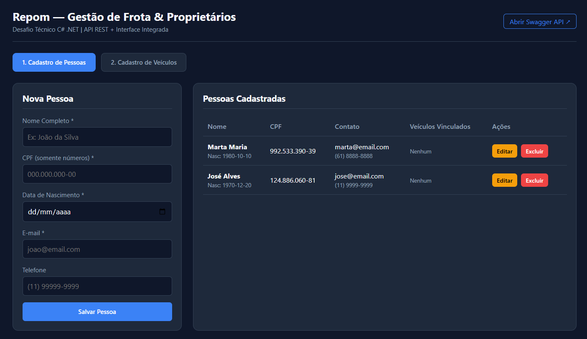
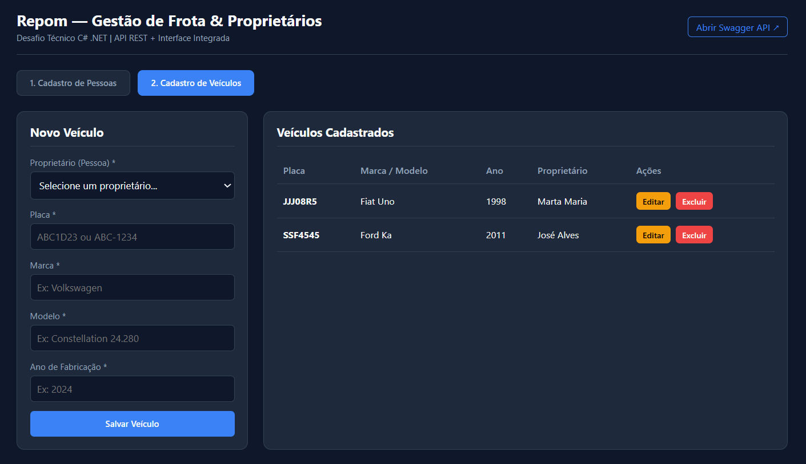

# Desafio Técnico C# — Cadastro de Pessoas e Veículos

API RESTful com interface web integrada para o gerenciamento de pessoas e seus respectivos veículos. A solução foi desenvolvida em **C#/.NET 10**, seguindo princípios de Clean Architecture e SOLID.

<p align="center">
  
  
</p>

## Tecnologias utilizadas

- **.NET 10 / C#** — ASP.NET Core Web API;
- **Entity Framework Core** e **SQLite** — persistência relacional sem necessidade de configuração externa;
- **Swagger/OpenAPI** — documentação interativa da API;
- **HTML5, CSS3 e JavaScript** — interface web servida pela própria aplicação;
- **xUnit e Moq** — testes unitários.

## Estrutura da solução

- `Repom.Domain` — entidades, regras e contratos do domínio;
- `Repom.Application` — casos de uso, serviços e DTOs;
- `Repom.Infrastructure` — persistência com Entity Framework Core e repositórios;
- `Repom.API` — endpoints HTTP, middlewares e interface web;
- `Repom.Tests` — testes automatizados.

## Pré-requisitos

- [.NET 10 SDK](https://dotnet.microsoft.com/download) instalado;
- Git, para clonar o repositório.

## Como executar

Clone o repositório e acesse a pasta do projeto:

```bash
git clone https://github.com/keodevspace/RepomCadastro.git
cd RepomCadastro
```

Execute os testes:

```bash
dotnet test
```

Inicie a API:

```bash
dotnet run --project Repom.API
```

Durante a inicialização, a aplicação configura o banco SQLite `repom_frota.db` e aplica as migrations disponíveis.

Após iniciar a aplicação, acesse as URLs exibidas no console:

- **Interface web:** `http://localhost:<PORTA>`;
- **Swagger/OpenAPI:** `http://localhost:<PORTA>/swagger`.

## Banco de dados

O banco de dados utiliza SQLite e é criado localmente pela aplicação. O arquivo `database_script.sql`, quando presente na raiz do projeto, contém o DDL para consulta e auditoria.

## Decisões arquiteturais

### Clean Architecture e SOLID

A solução separa responsabilidades entre domínio, aplicação, infraestrutura e apresentação, facilitando a manutenção, os testes e a evolução do sistema.

### Validações em múltiplas camadas

As regras de negócio, como unicidade de CPF e placa, formato de e-mail e ano de fabricação válido, são protegidas pelas entidades de domínio e pelos índices únicos do banco de dados.

### Tratamento global de erros

Um middleware centralizado converte exceções de domínio e registros não encontrados em respostas JSON padronizadas, utilizando os status HTTP apropriados.

### Interface integrada

A aplicação serve os arquivos estáticos da interface web diretamente por meio do diretório `wwwroot`, sem exigir um servidor frontend separado.

## Melhorias futuras

- Implementar a validação matemática dos dígitos verificadores do CPF;
- Adicionar paginação aos endpoints de listagem;
- Criar `Dockerfile` e `docker-compose.yml` para facilitar a implantação;
- Implementar autenticação e autorização com JWT;
- Adicionar testes de integração para os endpoints da API.
